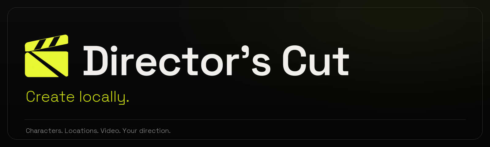
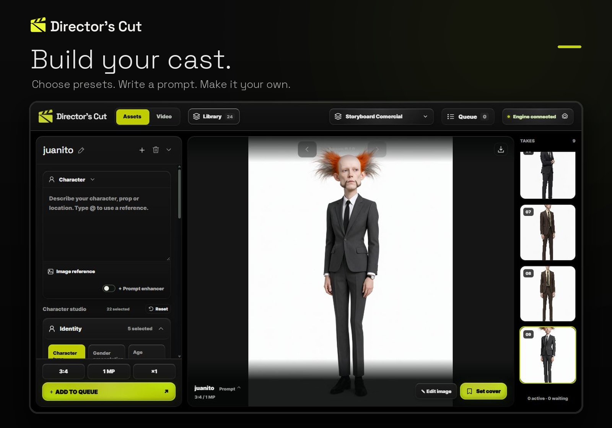
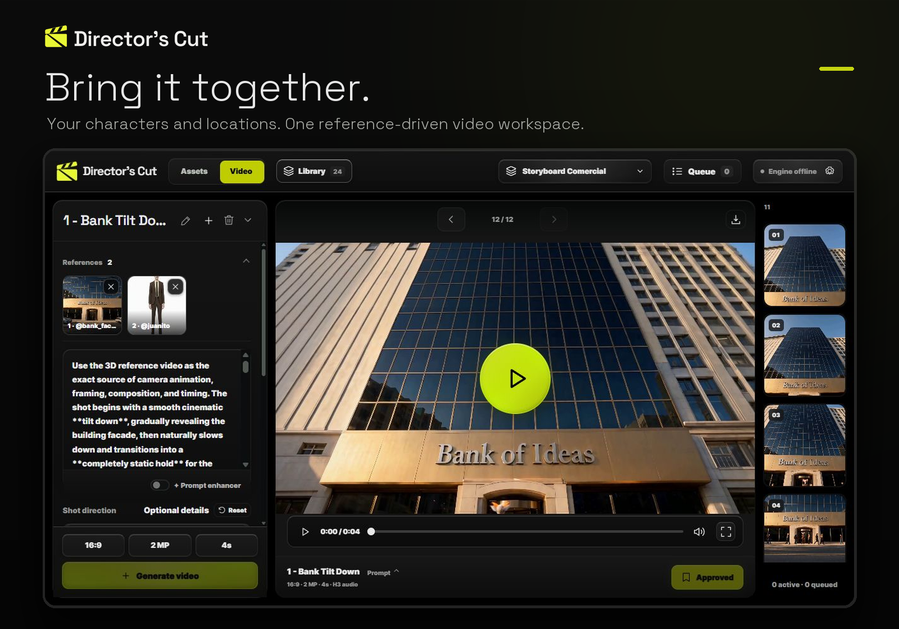

[](https://www.youtube.com/watch?v=Qbaz_HbrWo4)

[**Watch the 2-minute demo →**](https://www.youtube.com/watch?v=Qbaz_HbrWo4)



Create characters, props and locations, then bring them together in reference-driven video. Director’s Cut connects to your own ComfyUI and uses **Qwen-Image 2.1**, **MiniMax H3 REF2VA** and the official **Comfy SDK**.

## Download

[**Download for Windows — 0.1.0-rc.8**](https://github.com/leonardofrito/Directors-Cut/releases/download/v0.1.0-rc.8/DirectorsCut-0.1.0-rc.8-windows-x64.exe) · [All release files](https://github.com/leonardofrito/Directors-Cut/releases/tag/v0.1.0-rc.8)

| Platform | Available download |
| --- | --- |
| Windows x64 | [Download the EXE](https://github.com/leonardofrito/Directors-Cut/releases/download/v0.1.0-rc.8/DirectorsCut-0.1.0-rc.8-windows-x64.exe) — Python included |
| macOS | [Download the source package](https://github.com/leonardofrito/Directors-Cut/releases/download/v0.1.0-rc.8/DirectorsCut-0.1.0-rc.8-source.zip) — native app not published yet |
| Linux | [Download the source package](https://github.com/leonardofrito/Directors-Cut/releases/download/v0.1.0-rc.8/DirectorsCut-0.1.0-rc.8-source.zip) — native executable not published yet |

[Quick Start](packaging/QUICKSTART.md) · [Release notes](https://github.com/leonardofrito/Directors-Cut/releases/tag/v0.1.0-rc.8)

A compatible ComfyUI installation and model files are required separately. The current Windows build is an unsigned release candidate.

## Current source

Release rc.8 includes Asset Creation, Director’s Cut and Second Take character replacement with per-cut revisions. Explicit swap prompts go directly to H3 without automatic prompt expansion. [Second Take guide](docs/second-take.md).

## Bank of Ideas demo

Open **Projects → Bank of Ideas** to load the bundled example: 14 approved shots and 12 image references in a separate editable project. Model weights are separate; every generation requires your click.

Use **Library → Shots → Timeline** to arrange and trim clips on V1/V2 and A1/A2, preview the edit, and export MP4 or a DaVinci Resolve timeline. [Sequence and example guide](docs/sequence-and-examples.md).

## What you can make



- Characters, props and locations from presets, written prompts and image references.
- Image edits, alternate views and character details.
- H3 REF2VA videos using saved assets and optional motion or audio references.
- Project libraries with generation history, approved takes and reusable settings.

Optional local prompt enhancers and an MCP bridge are available. MCP host integration is still awaiting end-to-end user testing; it is not required to run the app.



## Getting started

Start ComfyUI, launch Director’s Cut and configure the connection to your ComfyUI installation and models folder. Missing catalog models have explicit downloads with pause/resume and file verification.

See [Quick Start](packaging/QUICKSTART.md) for installation and [ComfyUI connection](docs/comfy-connection.md) for Portable, Desktop, manual or remote setups.

## Models

Images use Qwen-Image 2.1. Video uses H3 REF2VA, with separate original, optional VSA and recommended Omni recipes. Selecting an Omni checkpoint chooses its matching recipe.

Model files are downloaded from their original publishers. Compatible Standard and optional GGUF formats are listed independently from text encoders and VAEs. Community variants are labelled; model licenses remain separate from the app license.

- [Model setup](docs/model-setup.md)
- [Downloads and supported variants](docs/model-downloads.md)
- [Image prompting and enhancers](docs/image-direction.md)
- [Assets and references](docs/asset-library.md)
- [Video workflows](docs/video-workspace.md)
- [Edit the default prompts](docs/editing-prompts.md)
- [Optional MCP setup](docs/mcp.md)

## Run from source

Use Python 3.12, or install [uv](https://docs.astral.sh/uv/). Download and extract the source package first.

**Windows:** run `setup.bat`, then `Start Director's Cut.bat`.

**macOS / Linux:**

```sh
sh setup.sh
sh start.sh
```

Open `http://127.0.0.1:7860`. Dependencies stay in the project's `.venv`; ComfyUI's environment is separate.

The Windows source launcher permits private-network access. The EXE uses localhost by default. For connection details, custom ports and remote models folders, read [ComfyUI connection](docs/comfy-connection.md).

## Development

The app uses an aiohttp backend, plain HTML/CSS/JavaScript and JSON project storage. No frontend build is needed. `tools/build_release.py` creates a native package on its target operating system.

Run checks relevant to your change. For the model downloader:

```sh
python -m unittest tests.test_model_downloads -q
```

Generation follows **Director’s Cut → Comfy SDK → Comfy API proxy → ComfyUI**. See the [official SDK guide](https://docs.comfy.org/development/api-development/sdks) and [self-hosted proxy guide](https://docs.comfy.org/development/comfyui-server/api-proxy).

## License

Director’s Cut's **application code is MIT licensed**. Model weights are not included and retain separate terms, including for local use. **MiniMax H3 has territorial and use restrictions**, also applicable to H3-based variants; the app's MIT license does not grant worldwide model or output rights. Read [Model licenses](docs/model-licenses.md) before using or distributing H3-based workflows. Dependency and reference notices are in [THIRD_PARTY_NOTICES.md](THIRD_PARTY_NOTICES.md).
